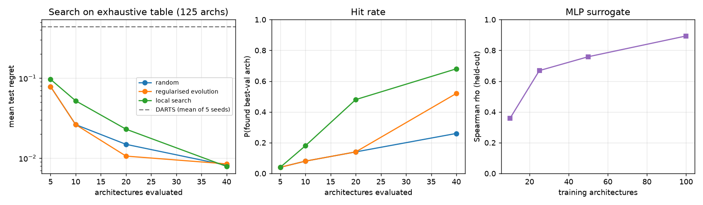
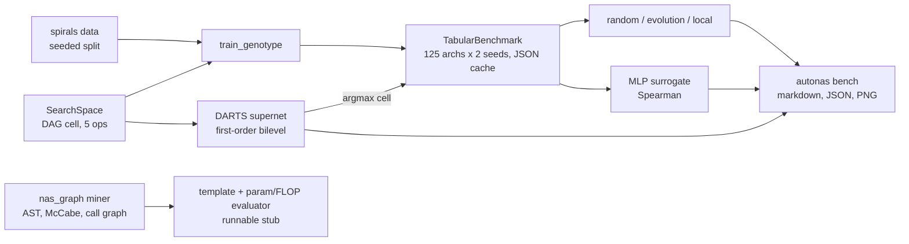

# Auto-NAS-Graph

**Neural architecture search you can check: every architecture in the space is trained, so each search strategy is scored against exact ground truth instead of anecdotes.**

[](https://github.com/Cyb0rg137ms/Auto-NAS-Graph-Architecture-Search-over-Code-Dependency-Graphs/actions/workflows/ci.yml)

[](LICENSE)



*Measured by `autonas bench --json docs/assets/bench.json --plot docs/assets/search_regret.png`: 125-architecture exhaustive table, 50 seeds per strategy, CPU, about 28 s end to end. The dashed line is first-order DARTS, which does worse than 5 random evaluations here.*

## Why it matters

NAS papers often compare search methods on spaces too large to evaluate exhaustively, so "found a good architecture" is hard to falsify. This repo builds a small tabular benchmark in the style of NAS-Bench-201: every cell in a 125-architecture space is trained on a seeded task. Random search, regularised evolution, local search, DARTS and a learned surrogate are then measured by **test regret** against the true optimum. The result includes a reproducible negative result for DARTS. The v1 code-base miner (AST → call graph → model stub) is kept and fixed.

## Key results

Task: 3-class interleaved spirals (600 points, noise 0.3, 50/25/25 split). Every number below comes from `autonas bench` (seeded).

| What | Result | Reproduce |
|---|---|---|
| Space | 125 archs (3-node cell, 5 ops/edge); val acc min / median / max = 0.340 / 0.690 / 0.960 | `autonas bench` |
| Best-val arch | `0->1:tanh_linear, 0->2:relu_linear, 1->2:tanh_linear`, test 0.9467 (oracle 0.9567) | `autonas bench` |
| Local search, 40 evals | finds best-val arch **68%** of the time (random: 26%, evolution: 52%) | `autonas bench` |
| Mean test regret, 20 evals | random 0.0149 · evolution 0.0106 · local 0.0230 | `autonas bench` |
| First-order DARTS (5 seeds) | test regret 0.21–0.66; one seed picked an all-`zero` cell | `autonas bench` |
| MLP surrogate, Spearman ρ | 0.358 (10 archs) → 0.669 (25) → 0.759 (50) → 0.894 (100) | `autonas bench` |
| Tests | 36 passed (11 original v1 tests unchanged) | `pytest` |

<details><summary>Full strategy table (mean test regret / P(found best-val), 50 seeds)</summary>

| strategy | 5 evals | 10 evals | 20 evals | 40 evals |
|---|---|---|---|---|
| random | 0.0785 / 0.04 | 0.0262 / 0.08 | 0.0149 / 0.14 | 0.0081 / 0.26 |
| regularised evolution | 0.0785 / 0.04 | 0.0262 / 0.08 | 0.0106 / 0.14 | 0.0085 / 0.52 |
| local search | 0.0966 / 0.04 | 0.0520 / 0.18 | 0.0230 / 0.48 | 0.0079 / 0.68 |

DARTS per seed:

| seed | chosen cell | val acc | test regret | val percentile |
|---|---|---|---|---|
| 0 | zero, zero, zero | 0.340 | 0.657 | 0.00 |
| 1 | linear, zero, skip | 0.597 | 0.323 | 0.32 |
| 2 | skip, zero, relu_linear | 0.720 | 0.210 | 0.58 |
| 3 | skip, skip, skip | 0.477 | 0.457 | 0.20 |
| 4 | linear, skip, zero | 0.433 | 0.557 | 0.10 |
</details>

## Architecture



Details: [docs/ARCHITECTURE.md](docs/ARCHITECTURE.md).

## 60-second quickstart

```bash
git clone https://github.com/Cyb0rg137ms/Auto-NAS-Graph-Architecture-Search-over-Code-Dependency-Graphs && cd Auto-NAS-Graph-Architecture-Search-over-Code-Dependency-Graphs
pip install torch --index-url https://download.pytorch.org/whl/cpu && pip install -e ".[dev]"
autonas bench --quick                      # seconds; full run: autonas bench (~30 s on CPU)
autonas search                             # DARTS on spirals, then retrain the chosen cell
pytest -q
```

Docker: `docker build -t autonas . && docker run --rm autonas bench --quick`

## Usage

```python
import torch
from autonas import SearchSpace, TabularBenchmark, TrainConfig, local_search, spirals

torch.set_num_threads(1)  # tiny MLPs: threading overhead dominates
space, data = SearchSpace(3), spirals()
table = TabularBenchmark.build(space, data, TrainConfig(steps=50))   # trains all 125 cells
trace = local_search(space, table.query, budget=40, seed=0)         # cost = number of table queries
best = max(trace, key=table.query)
print(space.describe(best), "test regret", round(table.test_regret(best), 4))
```

CLI:

```bash
autonas bench --json out.json --plot out.png --table cache.json
autonas mine path/to/repo --output_code model.py    # v1 code-base miner
```

## Design decisions and trade-offs

- **Exhaustive over impressive.** A small space that can be fully trained gives exact regret and hit rates. A large space would give unverifiable claims. The cost is that conclusions about scale do not transfer automatically.
- **Cost in evaluations, not seconds.** Strategies query a cached table, so comparisons do not depend on hardware and are cheap to repeat over 50 seeds.
- **Selection on validation, scoring on test.** Regret uses the test accuracy of the architecture chosen by validation, which separates search quality from overfitting to the selection metric.
- **A negative result reported as measured.** First-order DARTS collapses to parameter-free ops in this space. It is reported, not tuned away.
- **v1 kept, not deleted.** The `nas_graph` miner and template "search" keep their API. The template is now described as a template.

## Bugs fixed from v1

1. `benchmark.py` called `NASGraph.add_node` and `NASGraph.add_edge`, which did not exist. Both are now implemented,
   and topological sort raises `CycleError` instead of returning an order for a cyclic graph.
2. **`BENCHMARK_RESULTS.md` was not measured.** It reported, for example, R² 0.96 for a predictor fit to *random
   targets*, which is impossible. It has been removed, and every number in this README comes from `autonas bench`.
3. The parser keyed files by basename, so `a/utils.py` and `b/utils.py` overwrote each other. It also ignored
   `async def` and method calls, silently swallowed syntax errors, and scanned `.git/` and `__pycache__/`.
4. The legacy `MixedOp` accepted `in_channels != out_channels` and then crashed in `forward`, because MaxPool and
   Identity cannot change channels. It now raises a `ValueError` at construction.
5. The README called the rule-based `ArchitectureSearchEngine` a "search" that "solves a bilevel optimisation". It is
   a fixed template, and it is now documented as one. The real searches live in `autonas.strategies` and
   `autonas.darts`.

All 11 original tests pass unchanged. 23 new tests were added; one is parametrised over the three strategies, so the
total is 34.

## Limitations and roadmap

Full list: [docs/LIMITATIONS.md](docs/LIMITATIONS.md).
- The scale is a toy: MLP cells on a 2-D task, with no CIFAR or ImageNet.
- Seed noise makes regrets below about 0.01 unreliable.
- DARTS has no regularisers: no DARTS-PT and no second-order term.
- The surrogate is a one-hot MLP, not a GNN.
- There is no hardware-aware search.

Roadmap:
- [ ] Image task (e.g. a CIFAR-10 subset) with a convolutional cell space
- [ ] DARTS-PT and second-order DARTS to test whether the collapse persists
- [ ] GNN surrogate and Bayesian-optimisation strategy
- [ ] Measured latency as a search objective
- [ ] Import-aware resolution in the code miner

## Citation

```bibtex
@software{autonas_graph2026,
  author  = {Cyb0rg137ms},
  title   = {Auto-NAS-Graph: Neural Architecture Search Evaluated Against an Exhaustive Tabular Benchmark},
  year    = {2026},
  version = {2.0.0},
  url     = {https://github.com/Cyb0rg137ms/Auto-NAS-Graph-Architecture-Search-over-Code-Dependency-Graphs}
}
```

Methods: Real et al., *Regularized Evolution for Image Classifier Architecture Search*, AAAI 2019. Liu et al., *DARTS: Differentiable Architecture Search*, ICLR 2019. Dong & Yang, *NAS-Bench-201*, ICLR 2020.

## License

MIT. See [LICENSE](LICENSE).
