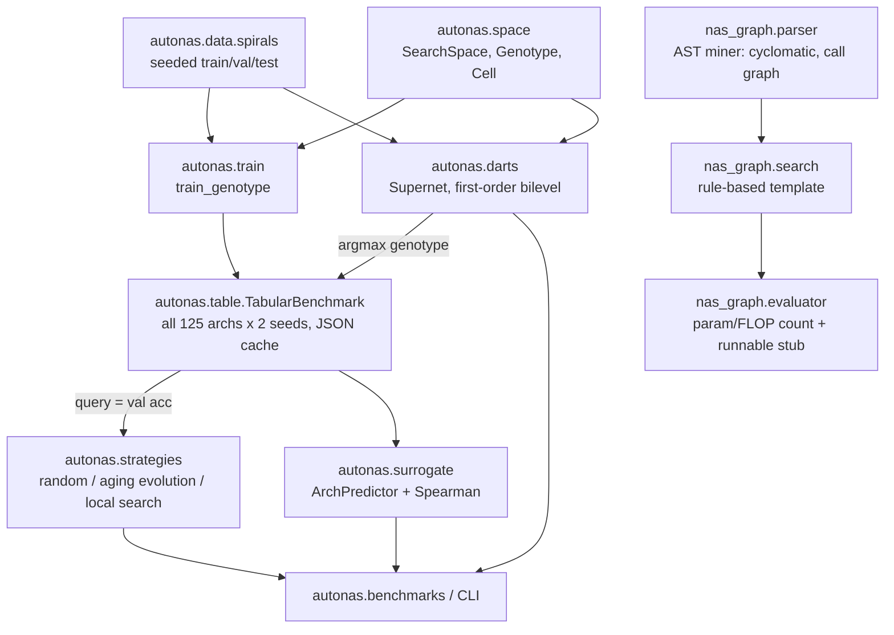

# Architecture

**Search space.** A cell is a DAG over `n_nodes` nodes, with an edge for every pair `i<j`. Each edge carries one of five
ops: `zero`, `skip`, `linear`, `relu_linear` or `tanh_linear`. Node `j` is the sum of its incoming edges, and the cell
output is the last node. The network is `Linear(2,W) → cell → ReLU → Linear(W,3)`. With `n_nodes=3` there are
5³ = 125 genotypes, few enough to train all of them and get exact ground truth.

**Search methodology.** Strategies query a precomputed table, so cost is counted in architecture evaluations. Each
strategy is evaluated by test regret, defined as best test accuracy in the space minus the test accuracy of the
incumbent selected by validation accuracy. Results are averaged over 50 seeds.

**Legacy `nas_graph` package (v1 API, kept).**
- The parser has been fixed; see the README.
- `ArchitectureSearchEngine` is a deterministic template. It is now documented as such.
- `ModelPerformanceEvaluator` now has a test showing that its parameter counts equal the generated module's real
  `numel`.
